## Создание и настройка ВМ

1. Осуществил создание двух виртуальных машин на базе ОС Windows и Ubuntu Linux, для проверки сделал `ping` с двух сторон, а затем создал клоны базовых ВМ.

## Часть 1. Подключение по ssh

2. На машине под управлением Ubuntu установил необходимый софт для развертывания ssh сервера

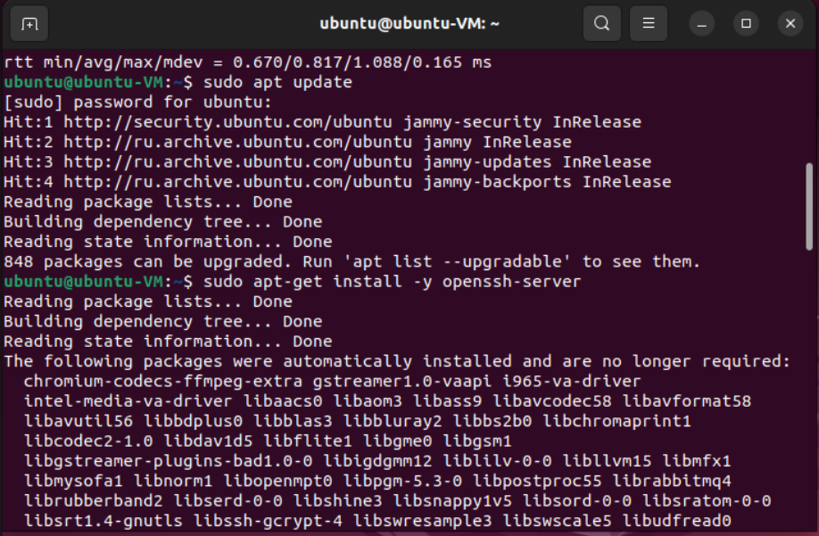

3. Проверил статус фаервола, чтобы он не ограничил подлючение в дальнейшем, добавил нового пользователя, к которому будет происходить подключение

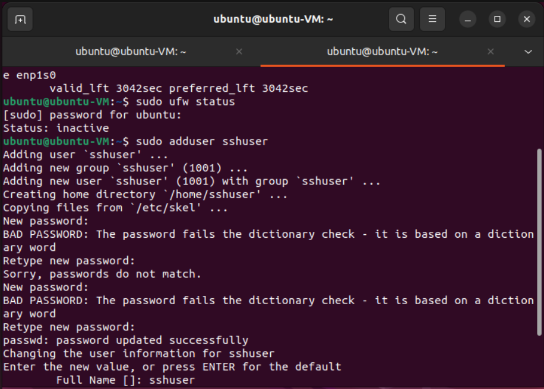

4. Осуществил первое подключение с машины Windows на машину Ubuntu по паролю

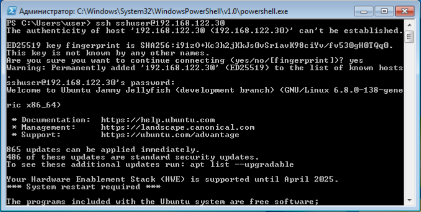

5. Сгенерировал ssh ключ на машине Windows с использованием команды ``ssh-keygen -t ed25519`` и передал его на на машину под управлением Ubuntu

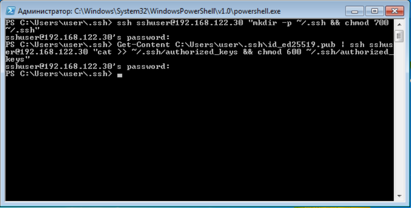

6. Попробовал осуществить подключение по переданному ключу

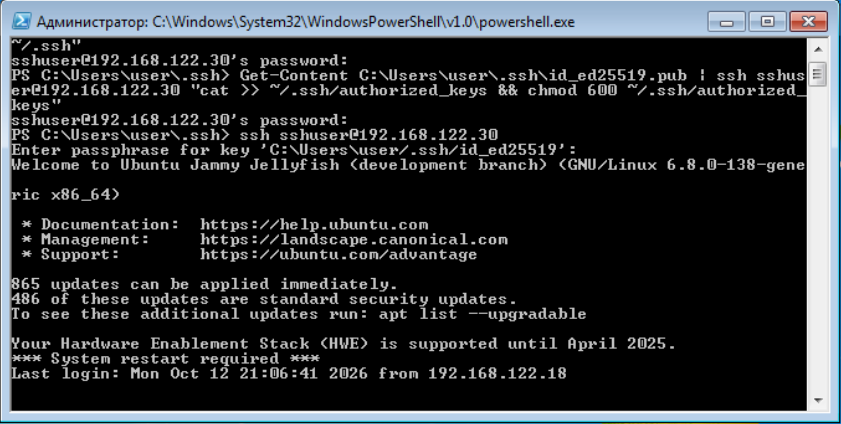

7. Запретил вход по паролю при подключении по ssh

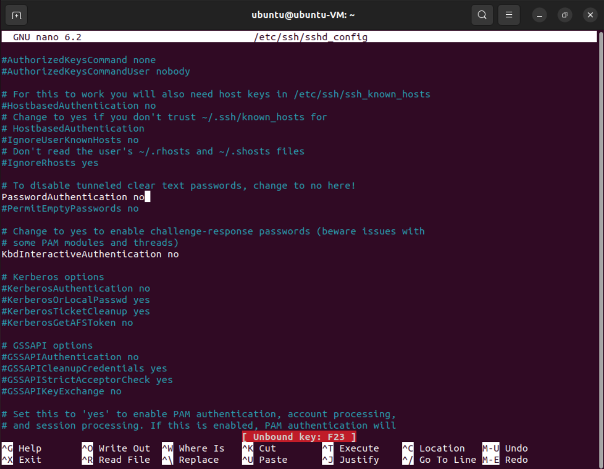

8. Проверил текущего пользователя и его права 

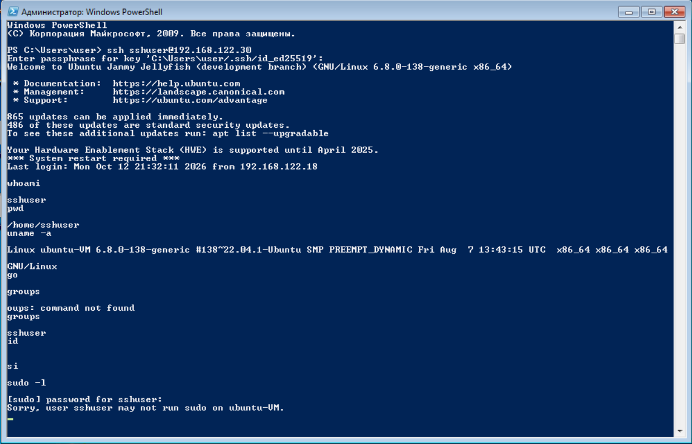

9. Остановил службу ssh и поменял порт на `222` вместо `22`

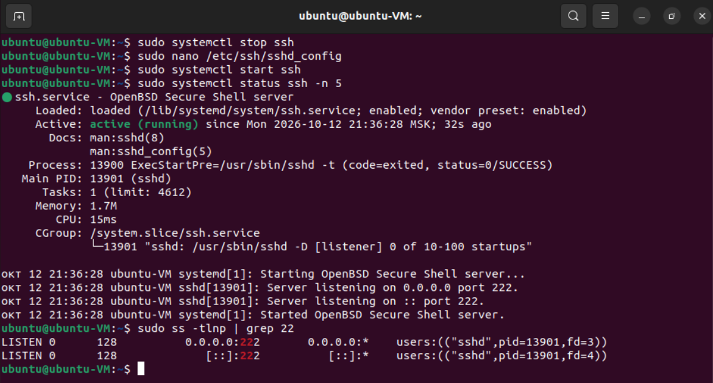

10. Попробовал зайти на сервер с новым портом

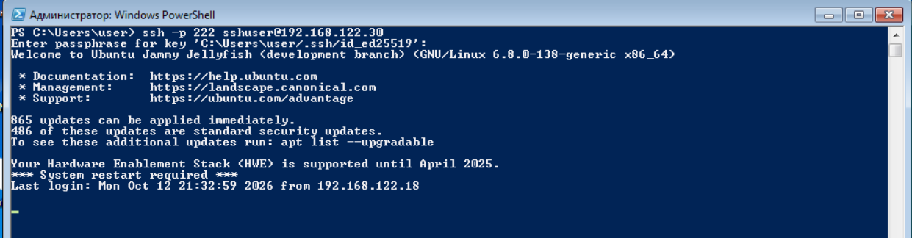

11. Вывел лог сервера ``sudo journalctl -u ssh -n 50``

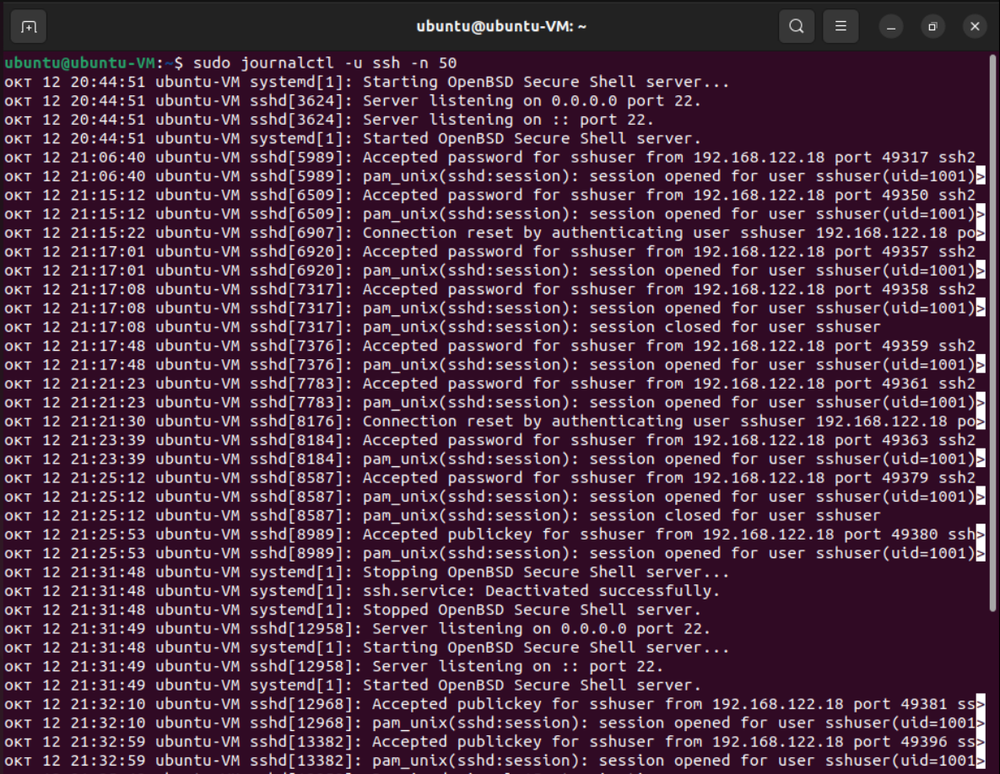

## Часть 2. Работа с xrdp

12. Сделал новые клоны базовых ВМ. На машине под управлением Ubuntu для нормальной работы перешел c wayland на xorg (x-server)

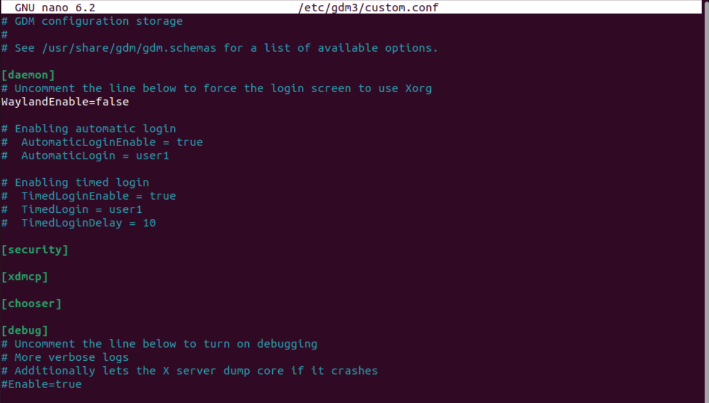

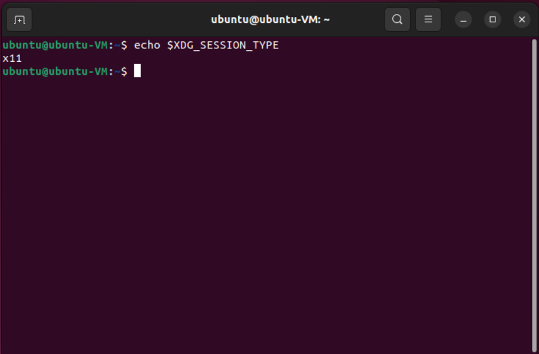

13. Установил xrdp

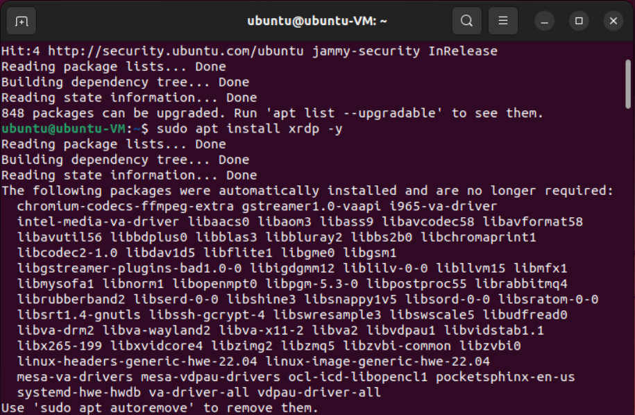

14. Добавил пользователя в необходимые группы

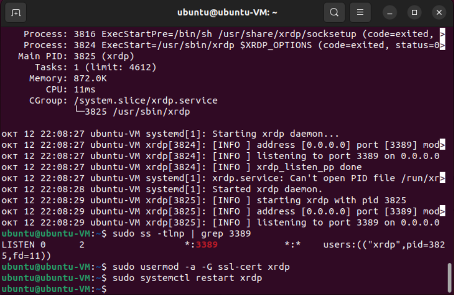

15. Осуществил настройку xrdp сессии. Будет использоваться DE GNOME, так как он уже установлен и не требует доп. настройки

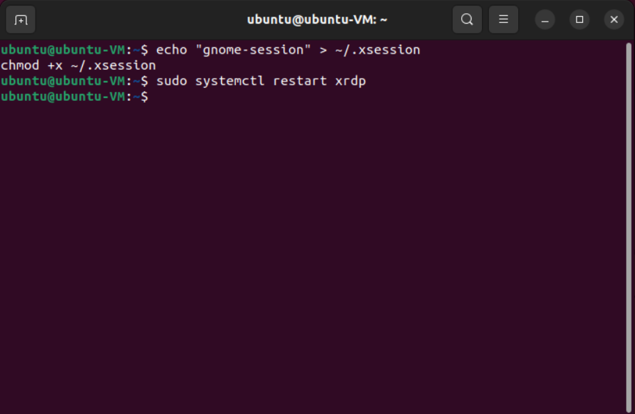

16. Подключился по протоколу rdp к настроенному серверу с машины Windows 

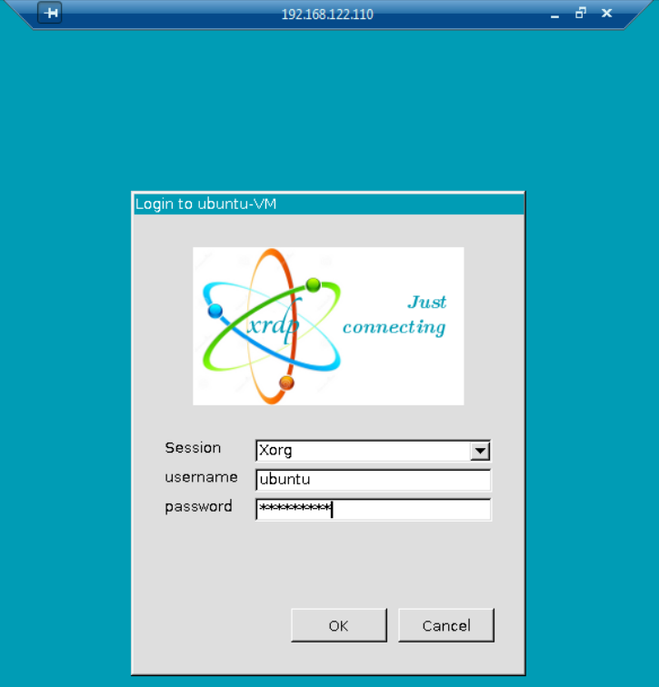

17. Проверил подключение по xrdp

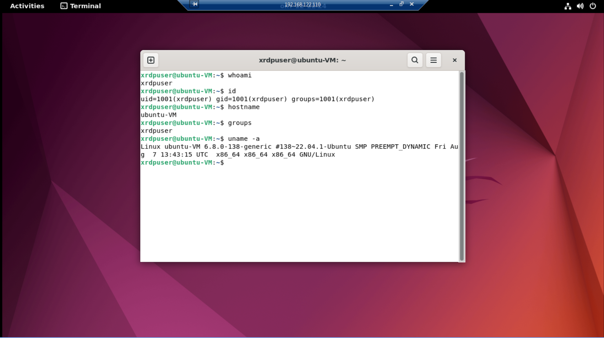
